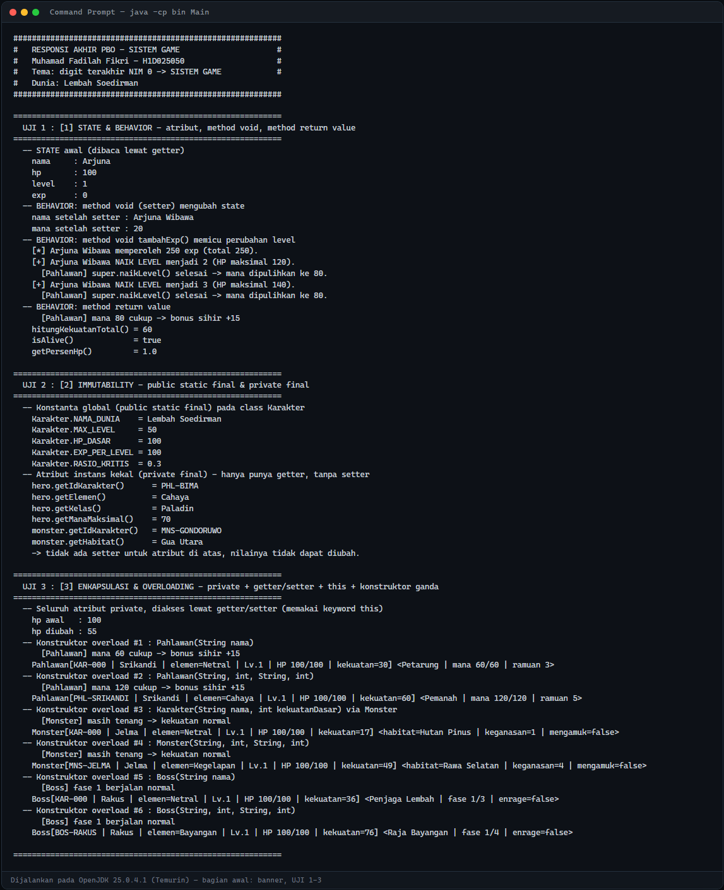
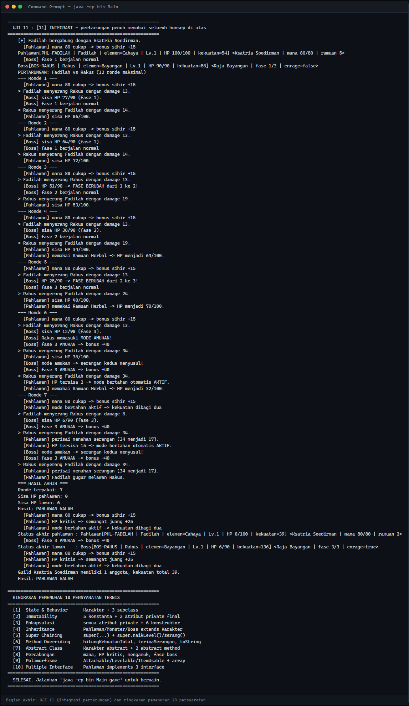
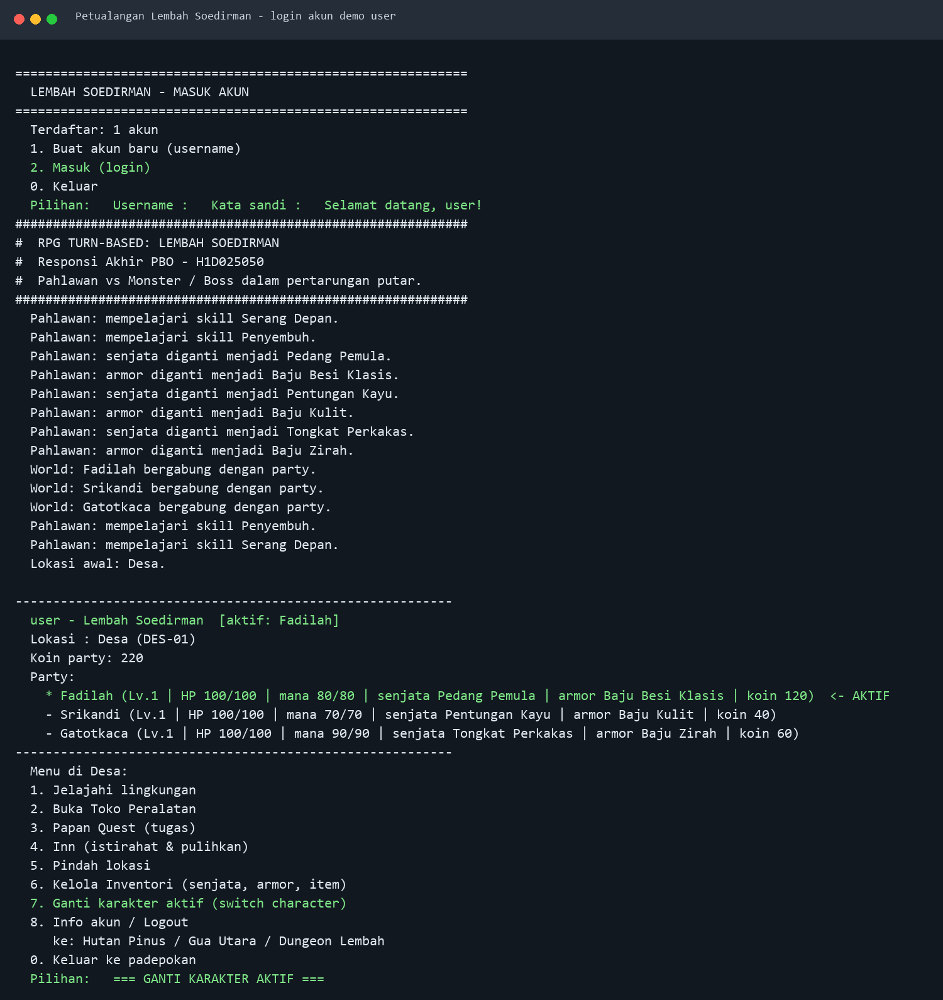
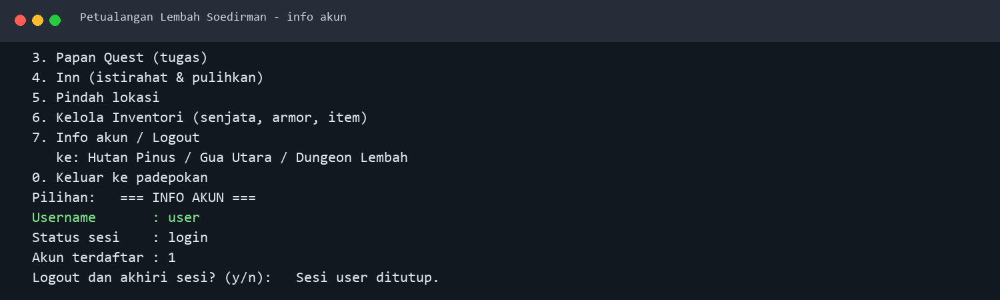

# Responsi Akhir PBO: Petualangan Lembah Soedirman

## Identitas

| Item | Keterangan |
|---|---|
| Nama | Muhamad Fadilah Fikri |
| NIM | H1D025050 |
| Prodi | Informatika, Fakultas Teknik, Universitas Jenderal Soedirman |
| Mata kuliah | Praktikum Pemrograman Berorientasi Objek |
| Tugas | Responsi akhir |

Digit terakhir NIM 0. Pada tabel tema di lembar penugasan, digit 0 dan 1 jatuh
ke tema Sistem Game, jadi project ini berupa game.

Gamenya diberi nama Petualangan Lembah Soedirman. Bentuknya pertarungan
turn-based di terminal, lengkap dengan karakter, naik level, item, peralatan,
toko, quest, peta dunia, akun pemain, dan guild.

---

## Compile dan run

Butuh JDK 17 ke atas. Pengujian dilakukan di OpenJDK 25.0.4.1. Tidak ada
library tambahan, semuanya dari Java Standard Library.

### Windows

```bat
cd "H1D025050_Muhamad Fadilah Fikri_RESPONSI AKHIR PBO"
rmdir /s /q bin 2>nul
mkdir bin
javac -d bin src\*.java
java -cp bin Main game
```

Atau langsung pakai skrip:

```bat
compile-run.bat
```

### Linux / macOS

```bash
cd "H1D025050_Muhamad Fadilah Fikri_RESPONSI AKHIR PBO"
rm -rf bin && mkdir -p bin
javac -d bin src/*.java
java -cp bin Main game
```

Atau:

```bash
chmod +x compile-run.sh && ./compile-run.sh
```

Kedua skrip mengompilasi dulu, lalu menjalankan mode pembuktian dan mencetak
perintah untuk masuk mode game di akhir.

### Dua mode

| Perintah | Mode | Input |
|---|---|---|
| `java -cp bin Main` | Pembuktian, 11 blok uji sesuai rubrik | Tidak perlu |
| `java -cp bin Main game` | Permainan interaktif | Perlu |

Mode pembuktian berjalan sendiri tanpa input. Kalau tidak ada input yang masuk,
aksi battle otomatis memilih Serang, jadi outputnya selalu sama dan bisa
diregenerasi kapan saja.

### Akun demo untuk asprak

Akun demo sudah tersedia otomatis setiap kali program dijalankan:

| Username | Password |
|---|---|
| `user` | `pass` |

Jalankan `java -cp bin Main game`, pilih 2. Masuk (login), lalu isi username
`user` dan kata sandi `pass`. Akun demo ini dibuat di komputer yang menjalankan
game, dan akun baru yang kamu buat ikut tersimpan permanen. Rinciannya ada di
bagian Penyimpanan akun.

Kalau mau menyimpan output ke berkas:

```bash
java -cp bin Main > output.txt 2>&1
```

---

## Struktur berkas

```
src/
├── Attackable.java      interface serang dan isAlive
├── Levelable.java       interface naik level dan tambah exp
├── ItemUsable.java      interface pakai item
├── AksiBattle.java      enum pilihan aksi saat bertarung
├── Akun.java            username, sandi, dan sesi login/logout
├── Karakter.java        superclass abstrak semua karakter
├── Pahlawan.java        karakter pemain
├── Monster.java         musuh biasa
├── Boss.java            musuh utama, 3 fase
├── Item.java            item dasar
├── Equipment.java       superclass senjata dan armor
├── Weapon.java          senjata
├── Armor.java           armor
├── Accessory.java       aksesori
├── Barang.java          entri barang yang dijual di toko
├── Skill.java           skill dengan biaya mana dan kekuatan
├── Shop.java            toko peralatan
├── Location.java        lokasi di peta
├── World.java           peta dunia, party, quest utama
├── Guild.java           kumpulan karakter
├── Pertarungan.java     battle 1 lawan 1
├── PartyBattle.java     battle gugus musuh
└── Main.java            entry point (pembuktian + game)
```

`bin/` berisi hasil kompilasi dan tidak ikut di-commit. Berkas lain di root:
`output.txt`, empat screenshot, `compile-run.bat`, `compile-run.sh`,
`.gitignore`, dan README ini.

---

## Screenshot



Screenshot lama, UJI 1 sampai 3.



Screenshot lama, UJI 11 dan ringkasan.

Kedua screenshot lama tetap disimpan. Setelah perbaikan EOF di Pertarungan dan
PartyBattle, output di-render ulang dan disimpan terpisah supaya riwayatnya
tidak hilang:



Screenshot terbaru: login akun demo `user`, lalu tampilan awal game setelah berhasil masuk.



Screenshot terbaru: menu Info akun / Logout yang menampilkan username `user`,
status login, jumlah akun terdaftar, dan konfirmasi logout.

Semua screenshot terbaru dihasilkan dari sesi game teruji dengan akun demo
`user` / `pass`. Output pembuktian tetap diregenerasi lewat:
`java -cp bin Main > output.txt 2>&1`.

---

## Sepuluh persyaratan teknis

| No | Konsep | Penerapannya |
|---|---|---|
| 1 | State dan behavior | Atribut `hp`, `level`, `exp`, method `setHp()`, `naikLevel()`, `isAlive()` di `Karakter` |
| 2 | Immutability | Konstanta `public static final` di `Karakter`, atribut `private final` seperti `idKarakter`, `elemen` |
| 3 | Enkapsulasi dan overloading | Semua atribut private, getter/setter, keyword `this`, beberapa konstruktor overload |
| 4 | Inheritance | `Karakter` superclass, `Pahlawan`/`Monster`/`Boss` extends; `Main` terpisah |
| 5 | Super chaining | `super(...)` di konstruktor, `super.naikLevel()`, `super.serang()`, `super.toString()` |
| 6 | Method overriding | Method subclass memakai `@Override` |
| 7 | Abstract class | `Karakter` abstract dengan `hitungKekuatanTotal()` dan `terimaSerangan()` |
| 8 | Percabangan | `if/else` untuk mana, HP kritis, monster mengamuk, fase boss |
| 9 | Polimorfisme interface | `Attackable penyerang = hero;` dan sejenisnya |
| 10 | Multiple interface | `Pahlawan implements ItemUsable, Levelable, Attackable` |

### Alur pengujian di Main

Main menjalankan 11 blok uji berurutan. Tiap blok mencetak nilai asli, bukan
cuma klaim, jadi tiap persyaratan bisa ditunjukkan satu per satu:

| Blok | Membuktikan |
|---|---|
| UJI 1 | State & behavior |
| UJI 2 | Immutability |
| UJI 3 | Enkapsulasi & overloading |
| UJI 4 | Inheritance |
| UJI 5 | Super chaining |
| UJI 6 | Method overriding |
| UJI 7 | Abstract class |
| UJI 8 | Percabangan |
| UJI 9 | Polimorfisme interface |
| UJI 10 | Multiple interface |
| UJI 11 | Integrasi, pertarungan penuh |

---

## Desain class

| Class | Fungsi |
|---|---|
| `Attackable` | Interface serang dan cek hidup |
| `Levelable` | Interface naik level dan tambah exp |
| `ItemUsable` | Interface pakai dan hitung item |
| `AksiBattle` | Enum lima aksi saat battle |
| `Akun` | Username, sandi, daftar/login/logout |
| `Karakter` | Superclass abstrak karakter |
| `Pahlawan` | Pemain, punya mana, ramuan, mode bertahan |
| `Monster` | Musuh, mengamuk saat HP di bawah 40% |
| `Boss` | Musuh utama, 3 fase, menyerang dua kali saat amukan |
| `Item` | Item dasar |
| `Equipment` | Superclass senjata dan armor |
| `Weapon` | Senjata, bonus kekuatan |
| `Armor` | Armor, nilai pelindung |
| `Accessory` | Aksesori, bonus khusus |
| `Barang` | Entri toko, bungkus item atau equipment |
| `Skill` | Skill dengan biaya mana |
| `Shop` | Toko, stok dan harga |
| `Location` | Lokasi di peta |
| `World` | Peta dunia, party, quest |
| `Guild` | Kumpulan anggota, hitung kekuatan total |
| `Pertarungan` | Battle 1 lawan 1 |
| `PartyBattle` | Battle gugus musuh |
| `Main` | Titik masuk program |

---

## Cara main

Saat menjalankan `java -cp bin Main game`, yang muncul pertama bukan langsung
permainan, tapi menu akun. Pemain bisa membuat username baru atau login. Baru
setelah itu masuk ke dunia game.

### Akun dan sesi

Menu akun punya tiga pilihan:

| No | Pilihan |
|---|---|
| 1 | Buat akun baru (username) |
| 2 | Masuk (login) |
| 0 | Keluar |

Buat akun baru: username tidak boleh kosong dan tidak boleh sama dengan yang
sudah terdaftar. Masuk: sandi harus cocok dengan akun yang terdaftar. Setelah
login, header menu utama menampilkan username yang sedang aktif.

Dua pilihan di menu utama berhubungan langsung dengan sesi:

- 7. Ganti karakter aktif (switch character) menukar hero yang dipakai. Battle,
  toko, inn, inventori, dan skor akhir mengikuti karakter aktif yang baru.
  Karakter yang pingsan (HP 0) tidak bisa dipakai sampai dipulihkan di Inn.
- 8. Info akun / Logout menampilkan username, status sesi, dan jumlah akun
  terdaftar, lalu bisa mengakhiri sesi.

Penyimpanan akun dibahas di bagian Penyimpanan akun.

### Peta dunia

```
Desa Utama (DES-01) -> Hutan Pinus (HUT-01) -> Gua Utara (GUA-01)
                     -> Dungeon Lembah (DNG-01) -> Benteng Boss (BOS-01)
```

Menu di tiap lokasi:

| No | Menu | Fungsi |
|---|---|---|
| 1 | Jelajahi lingkungan | Encounter acak. Desa aman, hutan/gua/dungeon ada monster, Benteng Boss ada Rakus |
| 2 | Buka Toko Peralatan | Beli senjata, armor, aksesori, dan ramuan dengan koin |
| 3 | Papan Quest (tugas) | Lihat quest utama dan progress |
| 4 | Inn (istirahat & pulihkan) | Pulihkan satu atau semua anggota party |
| 5 | Pindah lokasi | Masukkan kode lokasi tujuan |
| 6 | Kelola Inventori (senjata, armor, item) | Ganti senjata dan armor per karakter |
| 7 | Ganti karakter aktif (switch character) | Menukar hero yang dipakai di battle |
| 8 | Info akun / Logout | Lihat info akun dan akhiri sesi |
| 0 | Keluar ke padepokan | Akhiri permainan, tampilkan skor |

### Battle

Saat encounter, battle berjalan per ronde dengan menu:

```
1. Serang
2. Pertahanan
3. Pakai Item
4. Pakai Skill
5. Lari
```

`Pertarungan` untuk battle satu lawan satu. `PartyBattle` untuk gugus musuh.
Tiap ronde menampilkan HP, mana, dan musuh yang masih hidup.

### Aturan dasar

- Tiap 100 exp naik satu level, HP maksimal bertambah 20.
- Mana penuh memberi bonus kekuatan, mana menipis memberi penalti.
- HP di bawah 30% memicu mode bertahan yang memotong damage masuk.
- Monster mengamuk di bawah 40% HP.
- Boss punya 3 fase dan menyerang dua kali saat amukan.

## Penyimpanan akun

`Akun` menyimpan daftar pemain di `HashMap` statis, lalu menuliskannya ke
`akun.properties` di folder project setiap kali ada akun baru. Saat program
dijalankan lagi, file itu dibaca kembali sehingga username dan password tetap
bisa dipakai login. Password disimpan sebagai hash SHA-256, bukan teks biasa.

File `akun.properties` sengaja masuk `.gitignore` karena isinya data akun lokal
di komputer yang menjalankan game. Kalau project dipindah ke komputer lain,
akun lokal tidak ikut pindah: buat akun baru di sana atau salin file tersebut
secara manual.

---

## Catatan

- Atribut `private final` sengaja tidak diberi setter, sesuai ketentuan
  immutability. Atribut yang boleh berubah tetap punya getter dan setter.
- `javac -Xlint:all -d bin src/*.java` selesai tanpa keluaran dan exit 0 di
  OpenJDK 25.0.4.1, jadi tidak ada warning yang perlu dibersihkan.
- `Barang` dipisah dari `Shop` biar tidak memicu auxiliary class warning.
- `AksiBattle` dibuat enum supaya daftar aksi battle dipakai bersama oleh
  `Pertarungan` dan `PartyBattle`.
